# IaC with Terraform: AWS VPC, EC2 and an S3 Remote Backend

Terraform code that builds basic AWS networking and an EC2 instance, with the Terraform state stored remotely in S3 and locked with DynamoDB.

**Author:** Benjamin Ssempala
**Region:** `eu-west-1` (Europe, Ireland)
**Tools:** Terraform v1.17.1, AWS provider v6.71.0

## Architecture

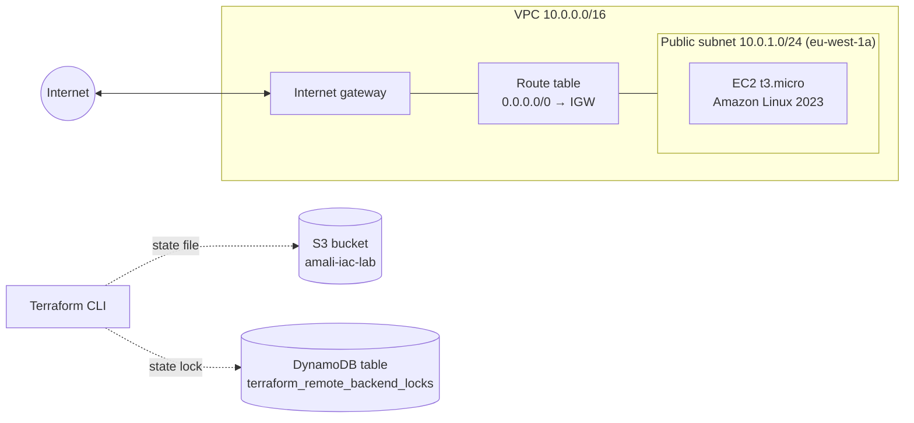

## Repository layout

```
iac_terra/
├── bootstrap/          # creates the backend: S3 bucket + DynamoDB lock table (local state)
│   ├── main.tf
│   ├── variables.tf
│   └── outputs.tf
├── infrastructure/     # the lab resources (state stored in the S3 backend)
│   ├── backend.tf      # terraform block: versions, providers, S3 backend
│   ├── provider.tf     # AWS provider + default tags
│   ├── main.tf         # VPC, subnet, IGW, route table, security group, key pair, EC2
│   ├── variables.tf
│   └── outputs.tf
└── *.png               # screenshots (see Evidence below)
```

**Why two folders?** The S3 bucket and DynamoDB table must exist *before* `terraform init` can use them as a backend. `bootstrap/` creates them once, keeping its own small state locally. `infrastructure/` then stores its state in that bucket.

## What gets created

| Folder | Resource | Details |
| --- | --- | --- |
| bootstrap | S3 bucket `amali-iac-lab` | versioning on, all public access blocked, `prevent_destroy` |
| bootstrap | DynamoDB table `terraform_remote_backend_locks` | partition key `LockID` (string), on-demand billing, `prevent_destroy` |
| infrastructure | VPC | `10.0.0.0/16`, DNS support and hostnames on |
| infrastructure | Public subnet | `10.0.1.0/24` in `eu-west-1a`, public IPs on launch |
| infrastructure | Internet gateway + route table | default route `0.0.0.0/0` to the IGW, associated with the subnet |
| infrastructure | Security group | see rules below (each rule is its own resource) |
| infrastructure | Key pair | generated by Terraform (see Design notes) |
| infrastructure | EC2 instance | `t3.micro` (standard CPU credits), latest Amazon Linux 2023, in the public subnet, IMDSv2 required, encrypted root disk |

### Security group rules

| Direction | Port | Protocol | Source / destination | Purpose |
| --- | --- | --- | --- | --- |
| Inbound | 22 | TCP | my public IP (`/32`) | SSH |
| Inbound | 80 | TCP | `0.0.0.0/0` | HTTP |
| Outbound | all | all | `0.0.0.0/0` | outgoing traffic |

## Remote backend

```hcl
backend "s3" {
  bucket         = "amali-iac-lab"
  region         = "eu-west-1"
  key            = "iacLab/terraform.tfstate"
  encrypt        = true
  use_lockfile   = true
  dynamodb_table = "terraform_remote_backend_locks"
}
```

Terraform 1.11+ shows a "Deprecated Parameter" warning for `dynamodb_table` and recommends S3-native locking (`use_lockfile`). Both are set: `use_lockfile` keeps a `.tflock` file next to the state in S3, and the DynamoDB table is kept because this lab requires it.

## How to run

**Prerequisites:** Terraform 1.11 or newer (needed for `use_lockfile`), and AWS credentials configured (`aws sts get-caller-identity` should work).

### 1. Create the backend (one time)

Create `bootstrap/terraform.tfvars`:

```hcl
bucket_name = "amali-iac-lab"
owner_tag   = "your-name"
```

```bash
cd bootstrap
terraform init
terraform apply
```

### 2. Deploy the infrastructure

The AMI is looked up from the public SSM parameter for the latest Amazon Linux 2023 image, so no `terraform.tfvars` is needed.

```bash
cd infrastructure
terraform init       # connects to the S3 backend (add -reconfigure if this folder was initialised before use_lockfile was added)
terraform plan
terraform apply
```

Connect to the instance with the SSH command printed as an output:

```bash
terraform output -raw ssh_command
```

### 3. Clean up

```bash
cd infrastructure
terraform destroy
```

The backend in `bootstrap/` is protected by `prevent_destroy`. To remove it too, delete the `lifecycle` blocks first, then run `terraform destroy` in `bootstrap/`.

## Design notes

- **SSH is limited to your own IP automatically.** A `data "http"` source looks up your public IP from `checkip.amazonaws.com` on every run. A postcondition checks the request succeeded, and a precondition on the security group checks the result is a valid CIDR before any rule is created.
- **Key pair.** If `~/.ssh/amali-iac-lab.pub` exists it is used. Otherwise Terraform generates a key with `tls_private_key` and saves the private key as `infrastructure/amali-iac-lab-key.pem` (permissions `0400`). The private key is then also stored in the state, which is why the state bucket is private, encrypted and versioned.
- **AMI.** Hard-coded AMI ids go stale: each Amazon Linux 2023 AMI is deprecated 90 days after release. An `aws_ssm_parameter` data source reads `/aws/service/ami-amazon-linux-latest/al2023-ami-kernel-default-x86_64` instead, so every apply uses the latest AMI (a newer AMI replaces the instance).
- **Instance type.** `t2.micro` is not free tier for accounts created after 15 July 2025; `t3.micro` is. T3 defaults to unlimited CPU credits, which can be billed, so `credit_specification` sets them to standard.
- **Tags.** `default_tags` in the provider adds `lab` and `owner` to every AWS resource.
- **Kept out of Git** (see `.gitignore`): `.terraform/`, state files, `*.tfvars` and `*.pem`.

## Evidence

### Terraform version (v1.5+)

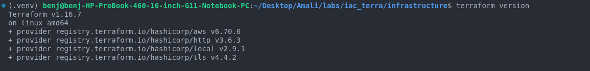

### terraform init

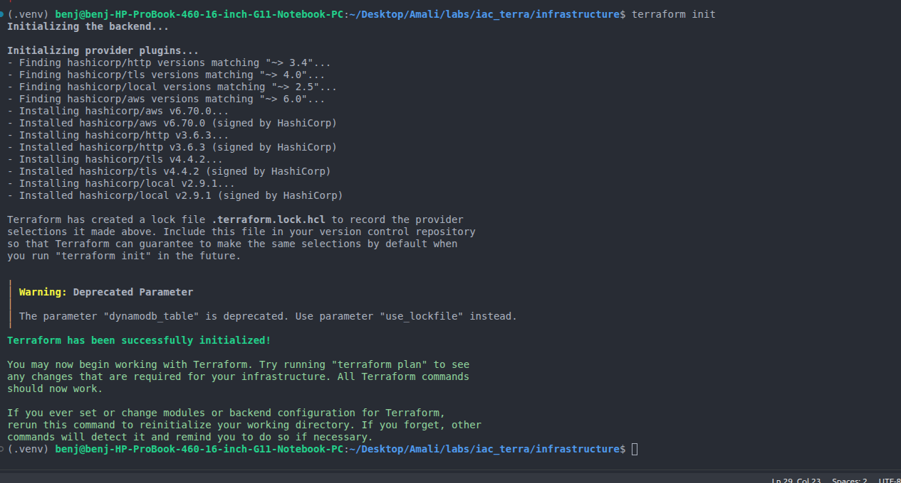

### terraform plan

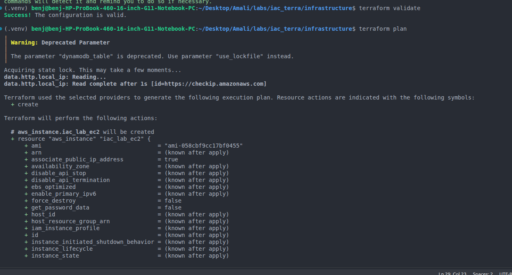

### terraform apply

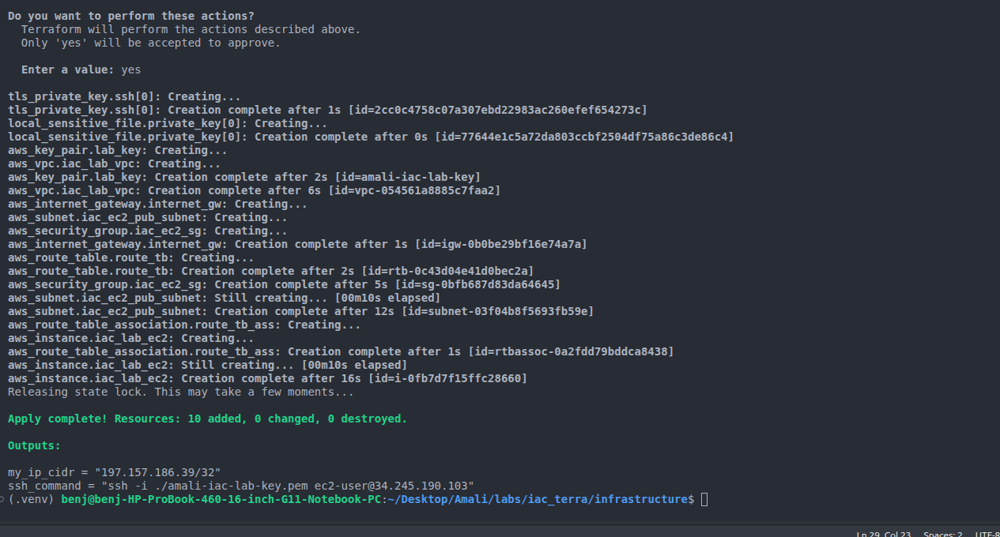

### AWS Console: EC2 instance

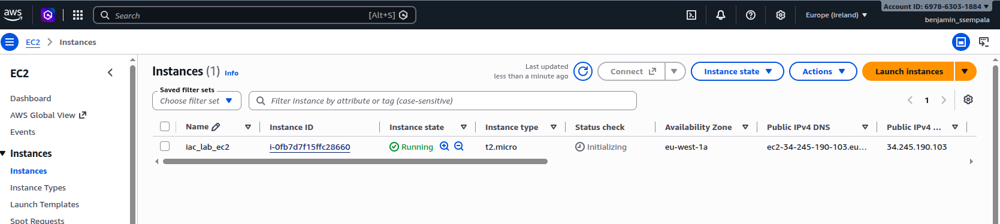

### AWS Console: VPC, subnet, internet gateway, route table, security group

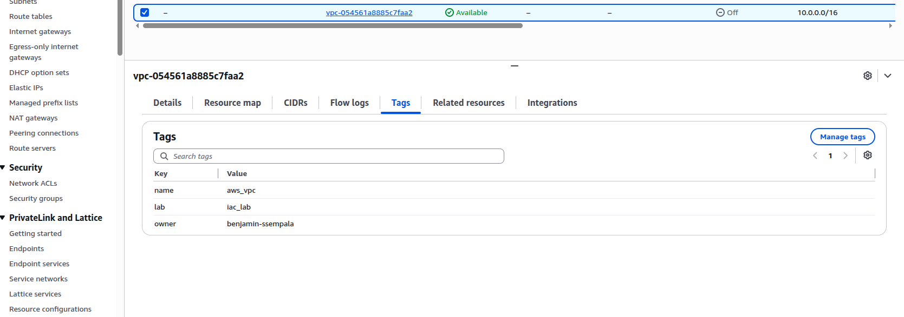
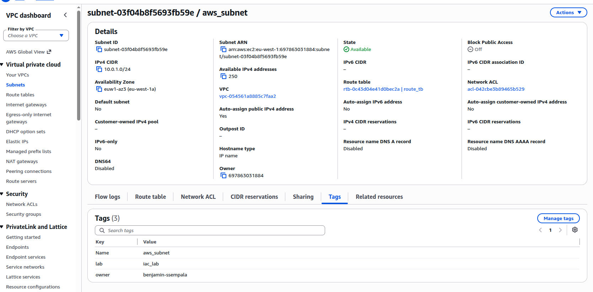
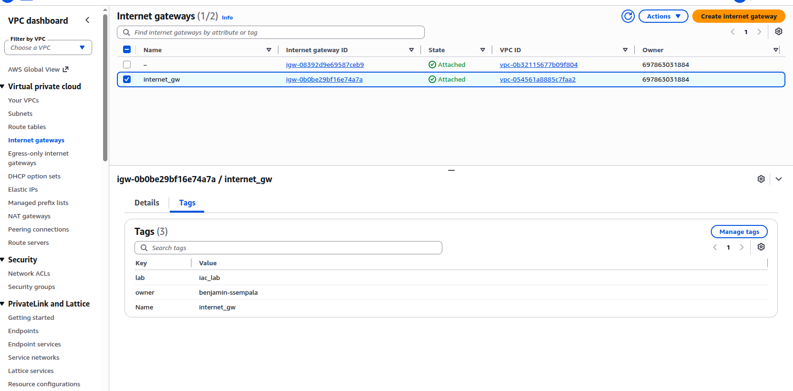
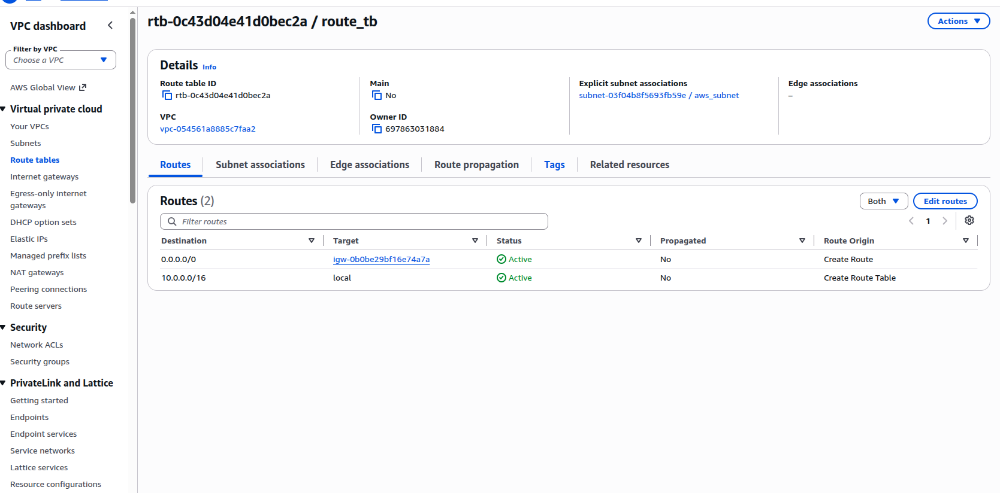
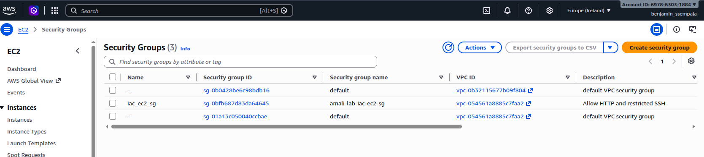

### Remote backend: state file in S3

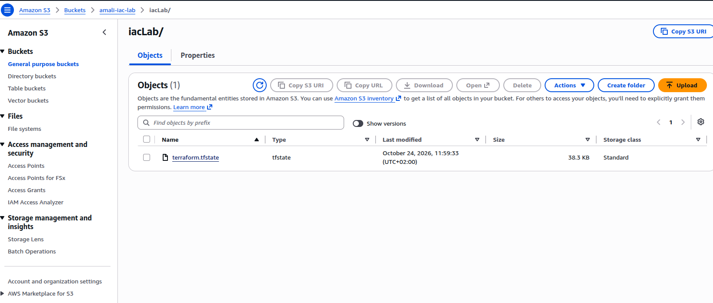

### Remote backend: DynamoDB lock table

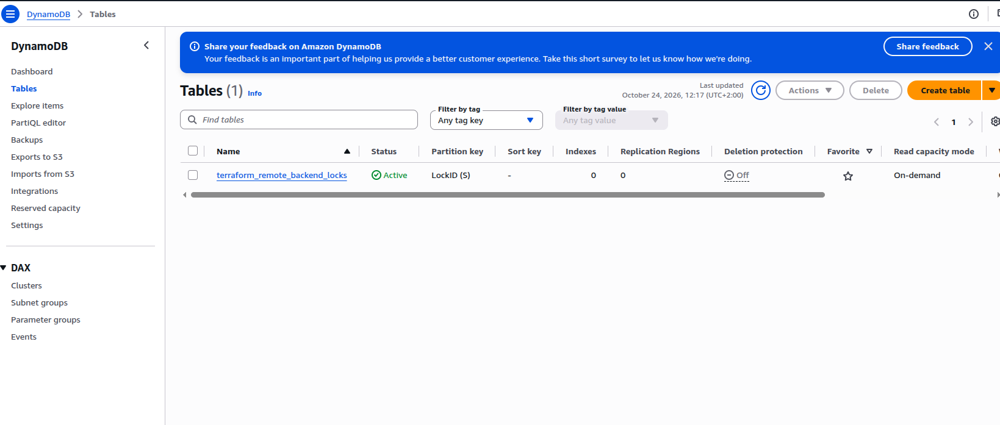

### terraform destroy

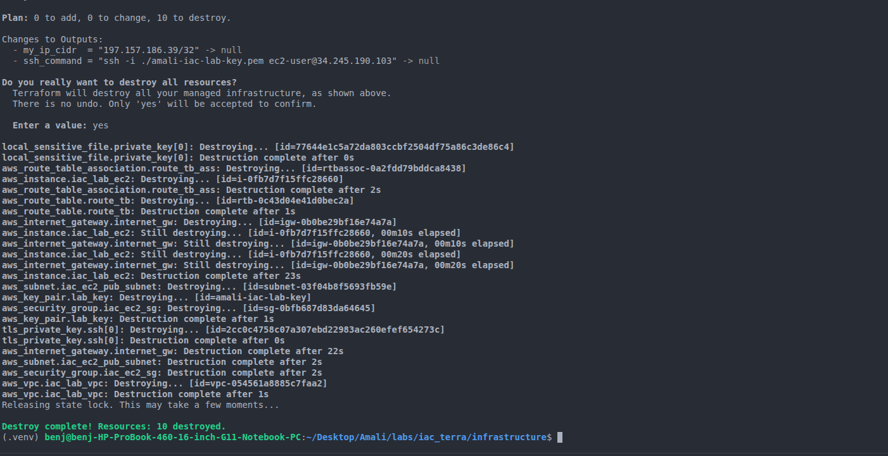
